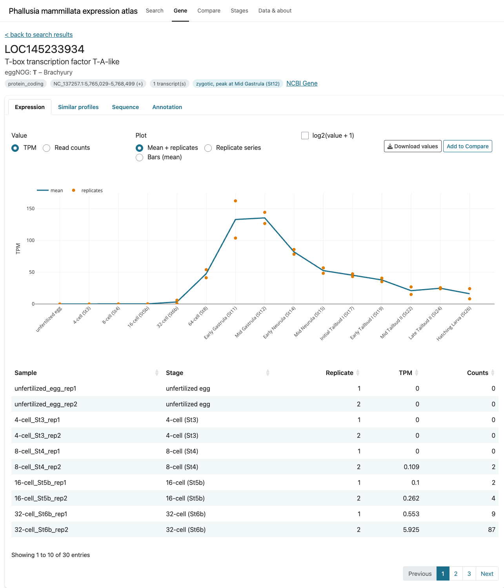

# phmamm-expression-atlas

**A gene expression atlas of *Phallusia mammillata* development: an R Shiny app and its database.**

About 37,000 genes (RefSeq nuclear genes + 35 mitochondrial genes annotated with MITOS2) x 15 developmental stages, from the unfertilized egg to the hatching larva (ENA PRJEB25149, two replicates per stage). You can search genes by name, description, protein domain, GO term or ID; plot their expression; find genes with similar profiles; see maternal / zygotic classes and peak stages; draw heatmaps for gene families; and get genomic / mRNA / CDS / protein sequences.

**Current version: v1.0.0** (see [CHANGELOG.md](CHANGELOG.md)). **How to use the app: [user manual](docs/MANUAL.md)** ([PDF](docs/phmamm-expression-atlas-manual.pdf)).



## Run the app on your computer (RStudio or Positron)

You need R (4.3 or newer) and RStudio or Positron. It takes about 5 minutes the first time.

**1. Get the code.** Either
- download it: on this page, **Code > Download ZIP**, then unzip, or
- clone it: in RStudio, **File > New Project > Version Control > Git**; in Positron, **File > New Folder from Git...**. Use the URL `https://github.com/AlenaKizenko/phmamm-expression-atlas.git`.

**2. Open the folder.** In RStudio, **File > Open Project...** (if you cloned) or set the working directory to the unzipped folder (**Session > Set Working Directory > Choose Directory...**). In Positron, **File > Open Folder...**.

**3. Install the R packages (once).** In the R console:
```r
install.packages(c("shiny", "bslib", "DBI", "RSQLite", "DT", "plotly"))
```

**4. Download the database (once, 255 MB).** It is too large for the repository, so it is attached to the release. In the R console, from the project folder:
```r
options(timeout = 1800)   # the default 60 s is too short for 255 MB
download.file("https://github.com/AlenaKizenko/phmamm-expression-atlas/releases/download/v1.0.0/phallusia.sqlite",
              "app/data/phallusia.sqlite", mode = "wb")
```
Or download `phallusia.sqlite` by hand from the [v1.0.0 release page](https://github.com/AlenaKizenko/phmamm-expression-atlas/releases/tag/v1.0.0) and put it in the `app/data/` folder.

**5. Start the app.**
```r
shiny::runApp("app")
```
Or open `app/app.R` and click **Run App** (RStudio) / the **Run Shiny App** button (Positron) at the top of the editor. The app opens in a browser window or the Viewer pane (click "Open in Browser" there for more room). Stop it with the red **Stop** button or **Esc** in the console.

If you skip step 4, the app starts with a small **simulated demo database** and shows a red "DEMO DATA" banner: the features work, but the genes and values are not real.

**Problems?** `there is no package called ...`: repeat step 3. `download.file` times out or stops: download the file by hand (step 4). The layout looks broken after a package update: install the exact tested versions with `install.packages("renv"); renv::restore(lockfile = "app/renv.lock")`.

## Files

```
app/app.R                    Shiny app (reads one SQLite file)
app/renv.lock                the R and package versions the app was tested with
app/data/demo.sqlite         SIMULATED demo database (the app shows a red DEMO banner with it)
database/build_database.py   makes the SQLite file from the pipeline output
database/make_demo_data.py   simulated input files in the real formats (for tests)
database/test_build.py       self-test of the builder
analysis/                    R/Quarto notebook for the counts: QC, temporal genes, clusters, tau, GO enrichment (see analysis/README.md)
deploy/deploy_shinyapps.R    checks and uploads the app to shinyapps.io
sample_metadata.csv          the 30 libraries (ENA run, ENA "Sample N", stage, replicate)
Dockerfile                   container for a server (installs the renv.lock versions; not tested yet)
docs/MANUAL.md               user manual (docs/phmamm-expression-atlas-manual.pdf is the same as a PDF)
```
The real database (`app/data/phallusia.sqlite`, 255 MB) is not in the repository; it is attached to each release (see above).

## Package versions

Tested (Nov 2026) with R 4.4.2, shiny 1.13.0, bslib 0.10.0, DT 0.34.0, plotly 4.12.0, RSQLite 2.4.6; the full list is in `app/renv.lock`. To get exactly these versions (recommended if the layout ever looks broken after a package update):
```r
install.packages("renv")
renv::restore(lockfile = "app/renv.lock")   # installs the recorded versions into a project library
```
Package updates can change the layout: bslib 0.5 and later squeeze pages into the window height unless the page is declared `fillable = FALSE` (it is, since Nov 2026), and DT tables need `fill = FALSE` inside cards.
The demo database contains random sequences and invented expression values; it exists to show and test the features.

## Build the real database

After the pipeline in `../phallusia_rnaseq` (steps 01, 01b, 01c (MITOS2), 03, plus eggNOG 04a/04b) has finished:

```bash
cd ~/Phallusia_mammillata          # the folder that contains ref_GCF_965637545.1/ and the pipeline folder
PIPE=phallusia_rnaseq              # the pipeline folder (the one with results/star_salmon/); any name works
EGG=$(find . -maxdepth 3 -name phmamm.emapper.annotations | head -1)   # 04b writes <BASE>/rnaseq_GCF_965637545.1/eggnog/
echo "$EGG"                         # must print a path
mkdir -p phallusia_app/app/data
srun --mem=8G --time=00:30:00 python3 phallusia_app/database/build_database.py \
  --gtf     ref_GCF_965637545.1/annotation_with_MT.gtf.gz \
  --genome  ref_GCF_965637545.1/genome_with_MT.fna.gz \
  --rna     ref_GCF_965637545.1/transcripts.fna.gz \
  --cds     ref_GCF_965637545.1/cds.fna.gz \
  --protein ref_GCF_965637545.1/proteins.faa.gz \
  --tpm     $PIPE/results/star_salmon/salmon.merged.gene_tpm.tsv \
  --counts  $PIPE/results/star_salmon/salmon.merged.gene_counts.tsv \
  --samples phallusia_app/sample_metadata.csv \
  --eggnog  "$EGG" \
  --extra-protein ref_GCF_965637545.1/MT_OZ281502.1.proteins.faa \
  --annotation "RefSeq annotation RS_2026_02 + mitochondrial genes (MITOS2)" \
  --out     phallusia_app/app/data/phallusia.sqlite
```
Python 3 standard library only. With the real inputs it takes under a minute and produces a database of about 255 MB. The app uses `app/data/phallusia.sqlite` when it exists, otherwise the demo database. **Read the WARNING lines the builder prints** (genes missing from the GTF, transcripts rebuilt from exons, eggNOG ids that match no protein). The ~9,000 tRNA and mitochondrial transcripts are always rebuilt from exons, because RefSeq's RNA FASTA does not contain them; that is expected. The warnings show a mismatch between inputs, e.g. files from different annotation releases.

## Put it online

GitHub stores the code (and, as release files, the database), but it does not run R. For a live app you need a Shiny host:

| Option | Notes |
|---|---|
| ISTA IT server / VM (recommended for the real database) | no size or hours limits; use the `Dockerfile` or install R + the packages of `app/renv.lock` and run `shiny::runApp("app", host = "0.0.0.0", port = 3838)` behind their web server |
| shinyapps.io | free plan: 5 apps, 25 active hours/month, bundles up to 1 GB, 1 GB RAM per instance. See "Deploy to shinyapps.io" below |
| Posit Connect Cloud | deploys R Shiny apps from a GitHub repository; free-plan limits are on Posit's plans page |

The real database is not committed (it is in `.gitignore`); it is attached to each GitHub release. For a citable DOI, the release can also be archived on Zenodo.

## Deploy to shinyapps.io

1. Make a free account at <https://www.shinyapps.io>. Open *Account > Tokens > Show*, copy the `rsconnect::setAccountInfo(...)` command and run it once in R.
2. Build the real database (above). Then, from this folder:
   ```bash
   Rscript deploy/deploy_shinyapps.R --check   # lists the files, the size and the detected R packages; uploads nothing
   Rscript deploy/deploy_shinyapps.R           # uploads; the first upload (~225 MB) takes a few minutes
   ```
   The app is then at `https://<account>.shinyapps.io/phallusia-atlas/`. To update it after a new database build, run the second command again.
3. The script refuses to upload the demo database (add `--allow-demo` for a test deployment), a database marked as demo, or a bundle over 900 MB.

Limits that matter (Posit documentation, Free plan): bundle up to 1 GB (ours: about 255 MB); default instance 1 GB RAM (the app peaked at about 250 MB for one session on a simulated 37,000-gene database; the stage-mean matrix for 'Similar profiles' adds about 10 MB and 1-2 s at start-up); one app instance and **one worker process**, so simultaneous visitors share one R process and a slow query (e.g. a big heatmap, ~2 s) briefly blocks the others; the app sleeps when idle, so the first visit after a pause is slower. The page is public. If it outgrows the free plan, use an ISTA server or a paid plan.
Not tested here: the upload itself (it needs your account). The checks above were tested, including the refusals.

## Tests

```bash
python3 database/test_build.py     # builder self-test on simulated inputs
bash analysis/test/run_test.sh     # analysis notebook on simulated counts with planted patterns (about 1 minute)
```
It checks, among others: every CDS translates to its protein; minus-strand genes are written 5'->3'; transcripts missing from the RefSeq RNA file are rebuilt from exons identically; protein/transcript IDs resolve to genes; "cadherin" finds the protocadherins too.

## Status and limits (v1.0.0, Nov 2026)

- Built from the real pipeline output (37,157 genes = 37,122 RefSeq + 35 mitochondrial; 36,109 quantified). Cross-checked: QC of all 30 libraries, stage labels (every library's nearest neighbour is the same replicate series at the adjacent stage), Brachyury (T-A-like) zygotic from the 32-64-cell stage, peaking at gastrula.
- The two replicates are two separate time courses (series 1 and 2): libraries of one series are more alike than the two libraries of one stage. The Expression tab can plot the two series as lines; the analysis notebook models the series as a batch (`~ replicate + stage`).
- Mitochondrial genome: the GenBank record OZ281502.1 has no gene annotation; the 13 protein genes, 2 rRNAs and 20 tRNAs (trnD, trnC not found) come from MITOS2 (genetic code 13). The MT proteins are MITOS2 translations (first codon written as Met), not NCBI records, and have no eggNOG annotation.
- Nuclear and mitochondrial genes are on **separate TPM scales** (builder option `--mt-prefix MT-`, default; the analysis notebook does the same): per sample, Salmon's TPM is rescaled so that the nuclear genes sum to 10^6 and, separately, the 33 MT genes other than the two rRNAs sum to 10^6 (MT-RNR1/2 use the same factor, so their values exceed 10^6). Reason: MT genes are transcribed in the mitochondria, not the nucleus, and take 15-29% of Salmon's TPM, changing with stage, which on one scale would shift every nuclear gene between stages. Counts are unchanged (DESeq2 uses counts). Nuclear TPMs are about 2% higher than in the old database (MT genome as one feature). The rRNAs are left out of the MT total because 16S rRNA (MT-RNR2) alone would be ~99% of it. MT genes get no maternal/zygotic class, and 'Similar profiles' compares MT genes only with MT genes.
- 1,048 RefSeq pseudogenes have no transcript records in the annotation, so they have no expression values (the app says so on their page).
- Maternal / zygotic class: "maternal" = at least 1 TPM in the unfertilized egg, "zygotic" = below 1 TPM in the egg but expressed later (a maternal gene may also be transcribed zygotically; polyA RNA-seq cannot tell). Shown with the peak stage (highest mean TPM).
- 'Similar profiles' = Pearson correlation of the 15 stage-mean log2(TPM + 1) values; similar timing, not proof of co-regulation.
- Search is a case-insensitive substring match over symbol, description, eggNOG name/description, Pfam, GO, KEGG and all IDs; every word must match.
- Expression is gene level (Salmon). Isoform-level expression, a genome browser, BLAST and ortholog links are not in v1.0.0.
- Only two replicates per stage: use the plots for patterns, not for statistics.

## Licence

- Code (app, database builder, analysis scripts): MIT licence, see [LICENSE](LICENSE).
- Database (`phallusia.sqlite`, release file) and the tables the app exports: [CC BY 4.0](LICENSE-data.md). The underlying reads are ENA PRJEB25149; the genome and annotation are NCBI RefSeq GCF_965637545.1. Please cite those sources as well.
