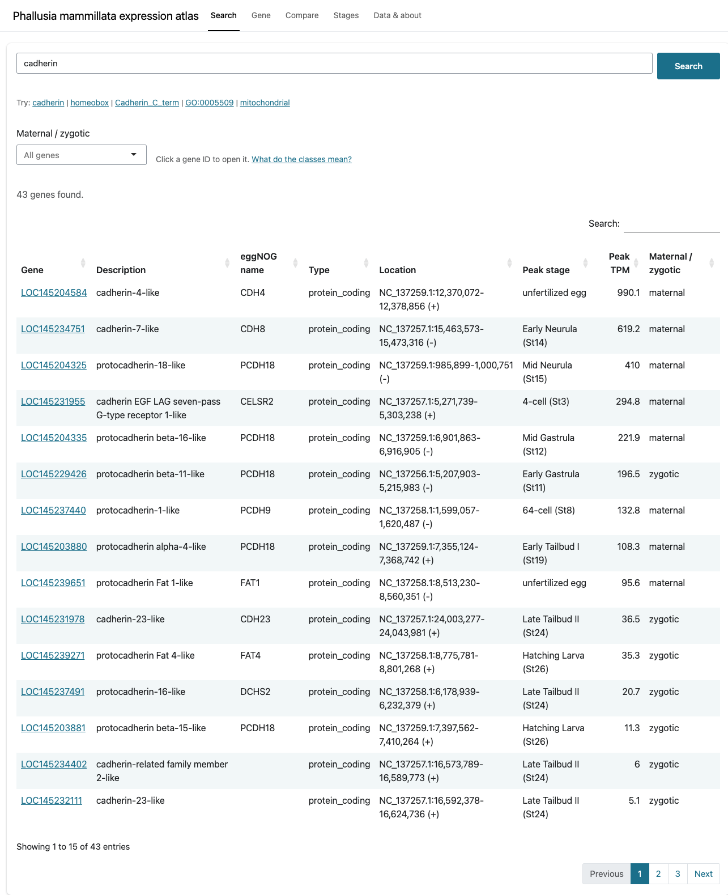
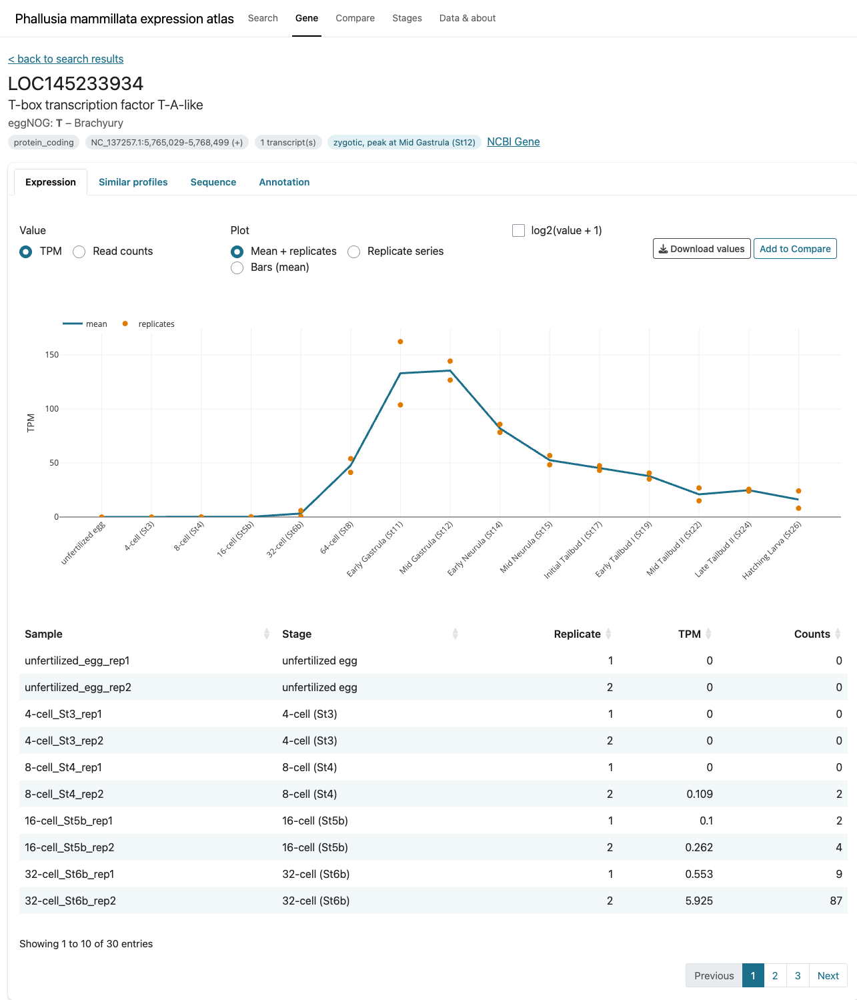
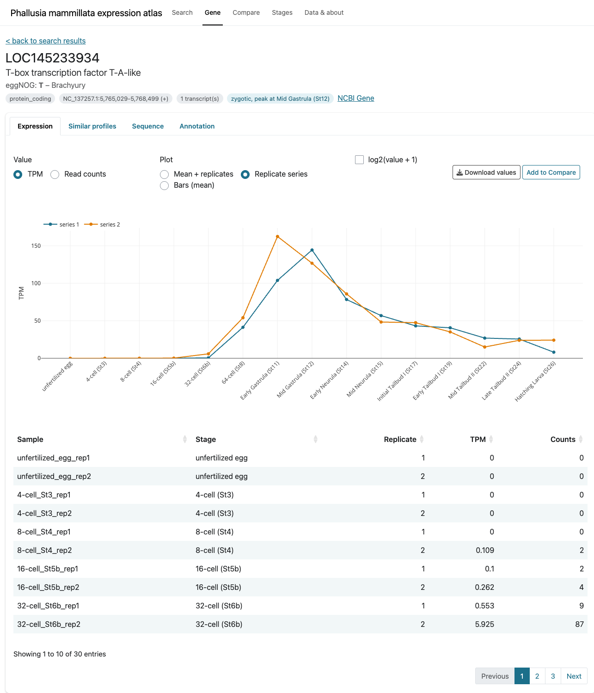
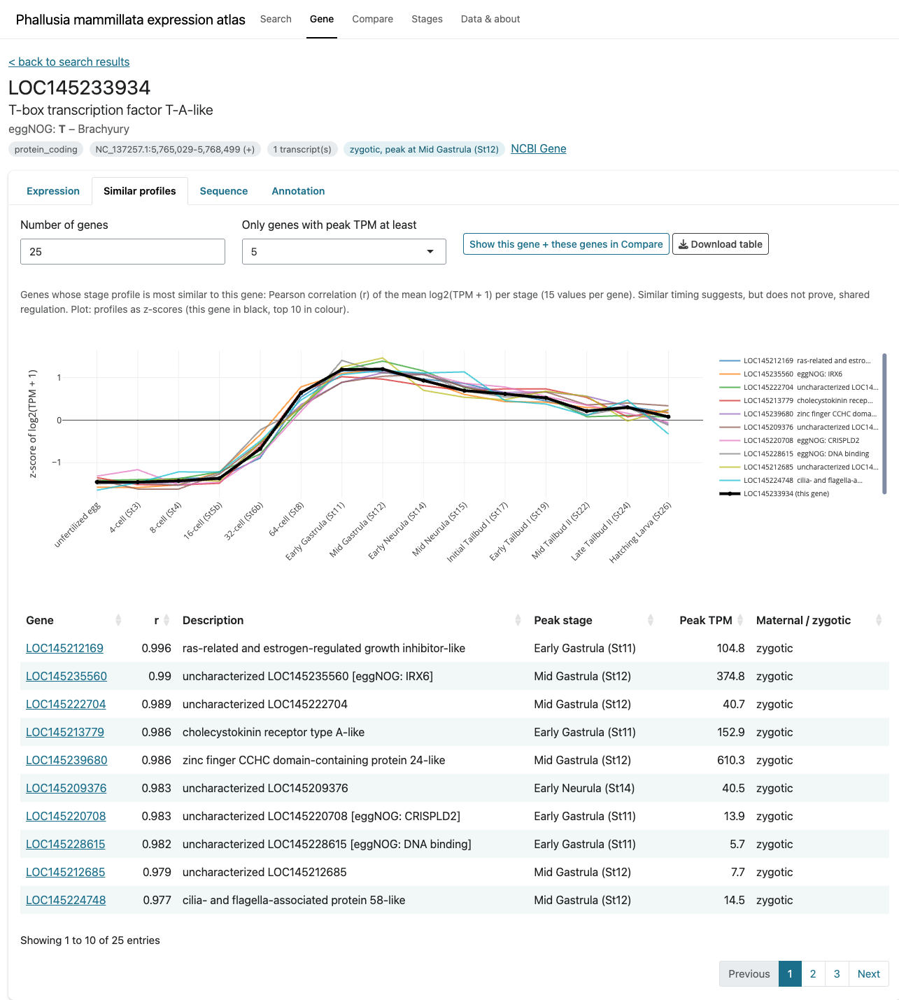
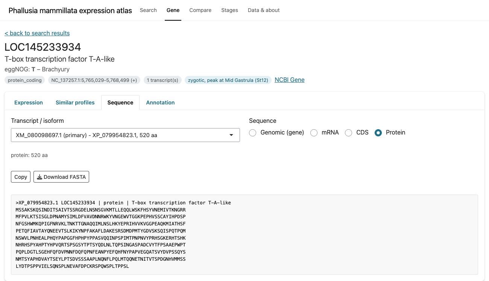
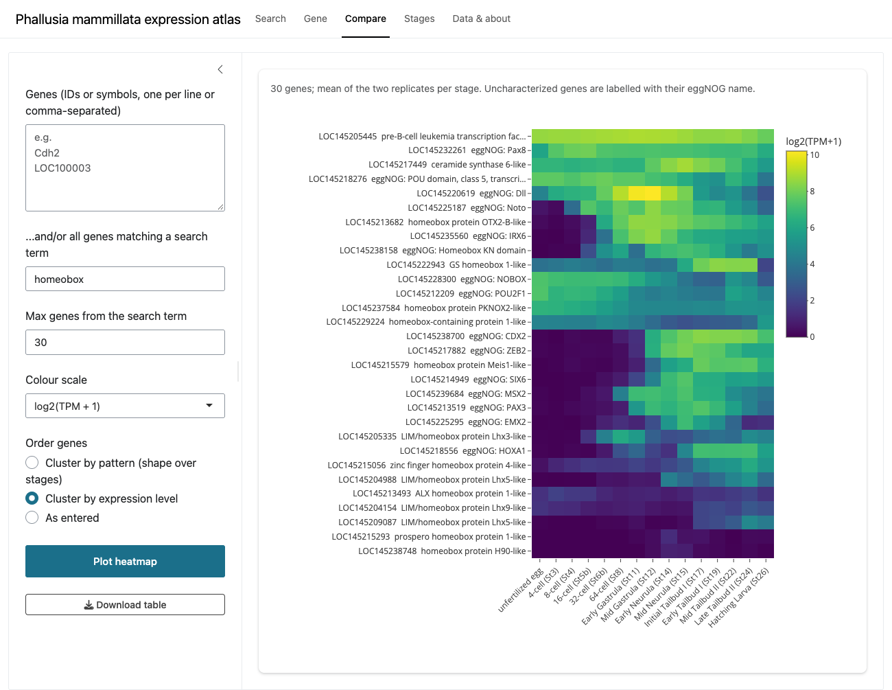
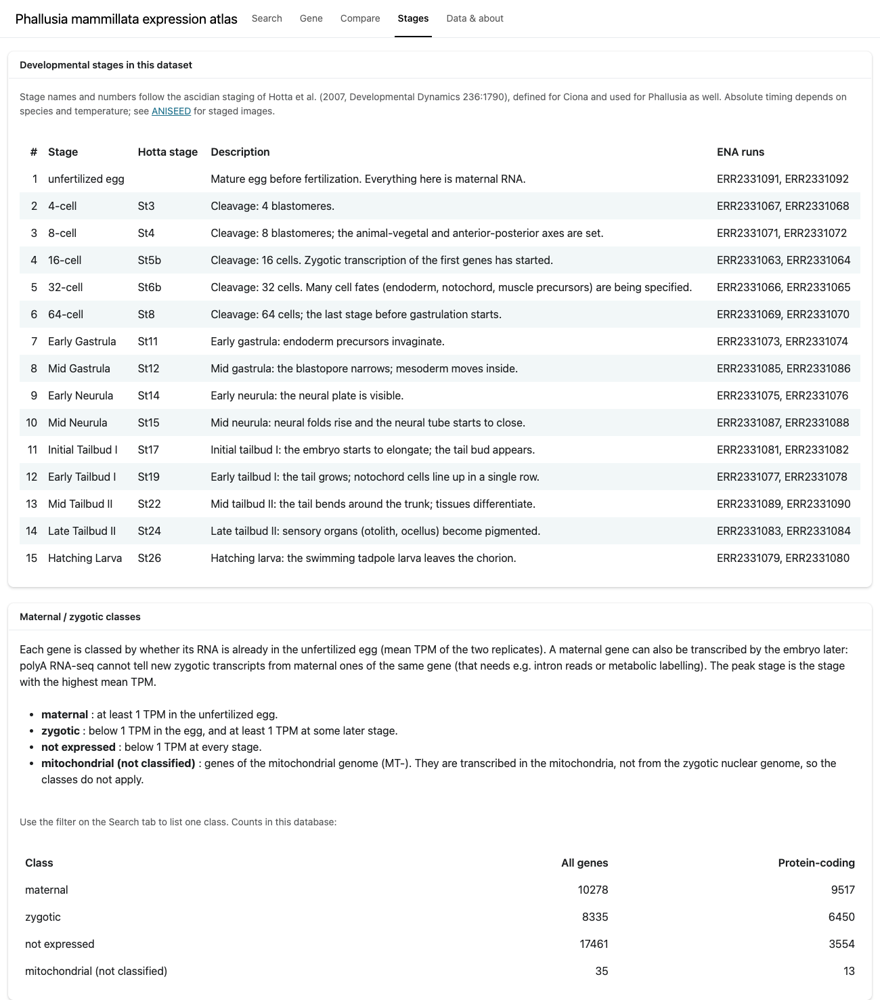
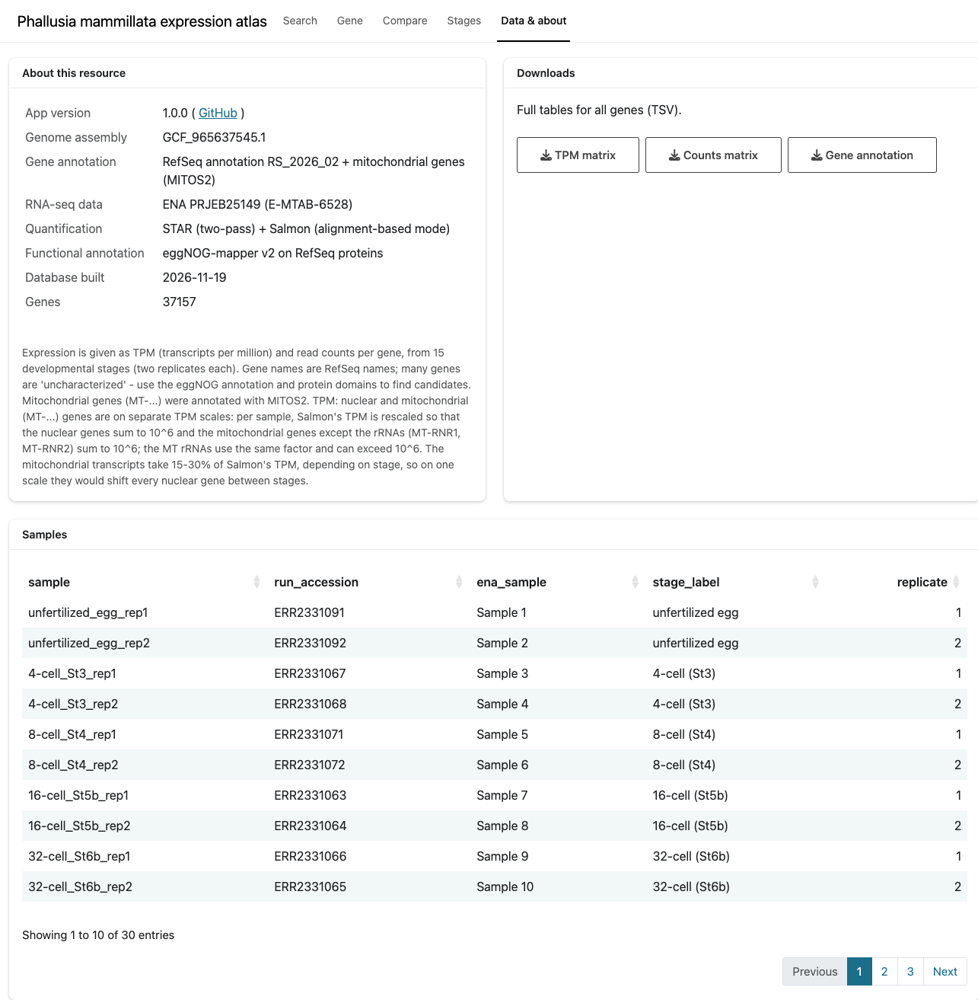

## What is in the atlas

The atlas shows how about 37,000 *Phallusia mammillata* genes are expressed across **15 developmental stages**, from the unfertilized egg to the hatching larva. Every stage has **two biological replicates** (public RNA-seq data, ENA PRJEB25149).

- **Genes**: the NCBI RefSeq annotation (GCF_965637545.1), plus 35 mitochondrial genes annotated with MITOS2. Many RefSeq genes are called "uncharacterized"; for those, the app also shows the **eggNOG** functional annotation (orthology-based name, protein domains, GO terms).
- **Expression values**: **TPM** (transcripts per million: comparable between genes and stages) and **read counts** per gene.
- **Stages**: named after the ascidian staging of Hotta et al. (2007). The **Stages** tab lists them with a short description.

To install and start the app on your computer, see the *Run the app on your computer* section of the [README](https://github.com/AlenaKizenko/phmamm-expression-atlas#readme). The rest of this manual explains how to use it.

The app has five tabs at the top: **Search**, **Gene**, **Compare**, **Stages** and **Data & about**.

## 1. Find a gene (Search tab)

Type into the search box and press **Enter** or **Search**. You can search for:

| What | Example |
|---|---|
| gene name or part of it | `cadherin`, `cadher`, `Brachyury` |
| words from the description | `T-box transcription factor` |
| eggNOG name of an uncharacterized gene | `SOX2`, `FOXA2` |
| protein domain (Pfam) | `Cadherin_C_term`, `Homeodomain` |
| GO term | `GO:0005509` |
| any identifier | `LOC145233934`, `XP_079954823.1`, `XM_080098697.1` |

- The search ignores upper / lower case and matches parts of words. With several words, **every word must match** (e.g. `homeobox LIM`).
- Results are sorted by how well they match, then by expression level.
- The **Maternal / zygotic** filter shows only one class (see section 4).
- The table can be sorted by clicking a column header, and filtered further with its own small **Search** box (top right of the table).
- **Click a gene ID** to open its page. Ctrl/Cmd-click opens it in a new browser tab.

## 2. Look at one gene (Gene tab)

The top of the gene page shows the gene ID, the RefSeq description, the eggNOG name, and small labels: gene type, genome location, number of transcripts, **maternal / zygotic class and peak stage**, and a link to NCBI Gene.

**Tip:** the address in the browser now ends in `?gene=LOC...`. Copy it to send a colleague a direct link to this gene (it works for anyone running the app at the same address).

### Expression

- **Value**: TPM or read counts. Use TPM to compare stages and genes; counts show how many reads the numbers are based on (a few reads means a noisy value).
- **Plot**:
  - **Mean + replicates**: the line is the mean of the two replicates; the orange dots are the replicates themselves.
  - **Replicate series**: one line per replicate (see below).
  - **Bars (mean)**: a bar chart of the mean, with the replicates as dots.
- **log2(value + 1)**: a log scale; useful when a gene is very high at one stage and low elsewhere.
- Hover over the plot to see exact values. The plot's toolbar (top right of the plot) zooms and saves the plot as a PNG.
- **Download values** saves the 30 values (TPM and counts per sample) as a CSV file.
- **Add to Compare** adds the gene to the gene list on the Compare tab.

**About the replicates.** The two replicates are two separate time courses (two batches of embryos, "series 1" and "series 2"). Samples of the same series are more similar to each other than the two samples of one stage. So look at whether the two series have the **same shape**, rather than comparing single points. With two replicates, the plots show patterns; they are not a statistical test.

### Similar profiles

Lists the genes whose expression over the 15 stages is most similar to this gene. Similarity is the Pearson correlation (*r*, from -1 to 1) of the mean log2(TPM + 1) per stage. The plot shows the profiles as z-scores (shape only), with this gene in black and the top 10 in colour.

- **Number of genes**: how many to list (5 to 200).
- **Only genes with peak TPM at least**: leaves out barely expressed genes, whose profiles are mostly noise.
- **Show this gene + these genes in Compare** draws them all as a heatmap.
- Similar timing suggests, but does not prove, shared regulation. A warning appears when the gene itself is barely expressed or hardly changes (a flat profile resembles many others).

### Sequence

Choose the **transcript / isoform** (the primary one is selected) and the sequence type:

- **Genomic (gene)**: the whole gene region including introns, written 5'->3' on the gene's strand.
- **mRNA**: the spliced transcript. **CDS**: the coding sequence. **Protein**: the translated protein.

**Copy** puts the FASTA text on the clipboard; **Download FASTA** saves it as a file. Non-coding RNAs have no CDS or protein.

### Annotation

The RefSeq annotation (location, transcripts and proteins, maternal / zygotic class, peak stage) and the eggNOG annotation: preferred name, description, Pfam protein domains, GO terms (linked to AmiGO), COG category, KEGG KO and orthologous groups.

## 3. Compare many genes (Compare tab)

Draws a heatmap of the mean expression per stage for many genes at once, for example a gene family.

1. Enter **gene IDs or names** (one per line, or separated by commas), and/or a **search term** (all genes that match it, up to **Max genes**). Genes added with **Add to Compare** on gene pages appear in the list.
2. Choose the **colour scale**:
   - **log2(TPM + 1)**: expression level; the default.
   - **Row z-score of log2(TPM + 1)**: each gene scaled to its own mean and spread, so you see when each gene is high or low, regardless of its level.
   - **TPM**: raw values; one very high gene can make all others look dark.
3. Choose how to **order the genes**:
   - **Cluster by pattern (shape over stages)**: genes with the same timing come together, whether they are expressed high or low. Use it to find groups of genes switched on at the same stage.
   - **Cluster by expression level**: genes are grouped by level and shape together, so the highly expressed genes cluster at the top and the weakly expressed ones at the bottom.
   - **As entered**: your order (search-term genes come after the listed ones).
4. Click **Plot heatmap**. Hover over a cell to see the gene, stage and value. **Download table** saves the mean TPM per stage of these genes.

Genes that were not found, or have no expression values (e.g. pseudogenes), are listed above the heatmap. Uncharacterized genes are labelled with their eggNOG name.

## 4. Stages and maternal / zygotic classes (Stages tab)

The table lists the 15 stages (Hotta stage numbers, a short description, and the ENA runs).

Every nuclear gene gets a simple class, based on the mean TPM of the two replicates:

- **maternal**: at least 1 TPM in the unfertilized egg, i.e. the RNA is already there before fertilization.
- **zygotic**: below 1 TPM in the egg, and at least 1 TPM at some later stage.
- **not expressed**: below 1 TPM at every stage.
- **mitochondrial (not classified)**: genes of the mitochondrial genome are not transcribed from the nuclear genome, so the classes do not apply.

The **peak stage** is the stage with the highest mean TPM.

A **maternal** gene can also be transcribed by the embryo later. RNA-seq of polyA RNA cannot tell new (zygotic) transcripts from maternal ones of the same gene; a rise after fertilization suggests new transcription, but check the expression plot.

## 5. Download data (Data & about tab)

- **About this resource**: app version, genome assembly, annotation, RNA-seq data, quantification pipeline and the date the database was built.
- **Downloads** (tab-separated text, opens in Excel or R): the **TPM matrix** and **counts matrix** (all genes x 30 samples) and the **gene annotation** (with eggNOG, maternal / zygotic class and peak stage).
- **Samples**: the 30 libraries with their ENA accessions.

## Good to know

- **Mitochondrial genes (MT-...)** have their own TPM scale: per sample, the mitochondrial genes sum to 10^6 separately from the nuclear genes. Compare them with each other, not with nuclear genes. Their similar-profile lists contain only mitochondrial genes.
- **Pseudogenes** have no transcripts in the RefSeq annotation, so they have no expression values; the gene page says so.
- Expression is **per gene**, not per isoform.
- A red **DEMO DATA** banner means the real database is missing and the app is showing simulated data (see the README, step 4: download the database).

## Citing

If you use the atlas, please cite this repository with its version (<https://github.com/AlenaKizenko/phmamm-expression-atlas>, v1.0.0) and the original data: ENA PRJEB25149 (RNA-seq) and NCBI RefSeq GCF_965637545.1 (genome and annotation). The database is CC BY 4.0, the code MIT.
